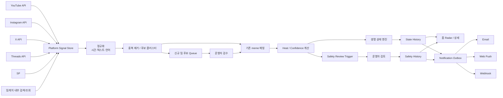
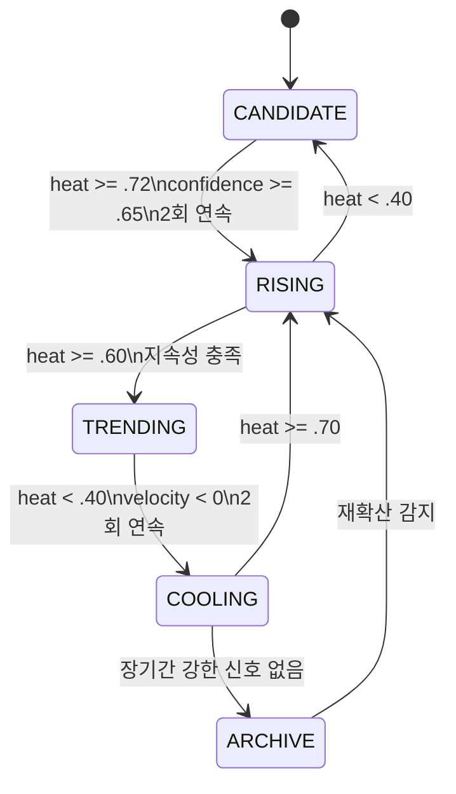
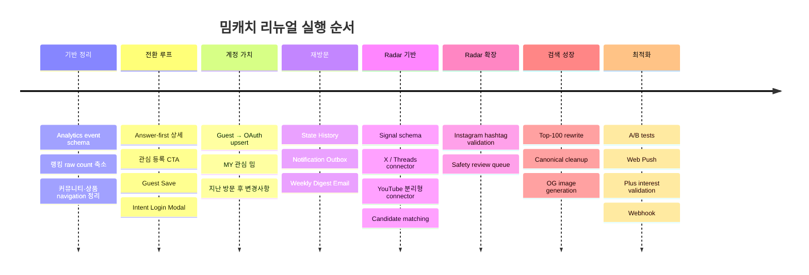

# 밈캐치 catchmeme.com 리뉴얼·트렌드 데이터 플랫폼 실행 계획

## 실행 요약

2026년 8월 11일 기준 밈캐치는 이미 “밈 뜻을 설명하는 사전”으로서 상당한 자산을 갖고 있다. 홈은 **“그 밈, 맥락까지 3초 안에”**를 핵심 약속으로 내세우고 약 3,906개 밈을 제공하며, 상세 문서에는 뜻·유래·사용 안전도·생명 게이지·출처·관련 밈·저장·공유 기능이 있다. 편집 원칙도 사실 확인, 저작권 확인, 안전 신호, 출처 역할, 자동 수집과 인간 검수를 명시해 일반적인 밈 모음 사이트보다 훨씬 좋은 기반을 갖췄다. citeturn1view0turn29view1

문제는 **제품의 가치가 “검색해서 한 번 보고 나가는 정보”에 집중되어 있고, 계정이 생겼을 때 얻는 가치가 아직 약하다는 것**이다. 현재 로그인 화면의 핵심 설명은 “로그인하면 밈 저장과 제보를 이어서 할 수 있어요”이고, 상세 페이지에서도 CTA가 “이 밈 저장하기”에 머문다. 반면 밈캐치가 이미 보유한 가장 차별적인 데이터는 **급상승·유행 중·식는 중·추억 밈 같은 생명 상태와, 써도 됨·맥락 주의·쓰면 위험 같은 사용 판단이 시간이 지나면서 변경될 수 있다는 점**이다. 즉 계정의 진짜 가치가 “저장”이 아니라 **“변화를 추적하고 알려주는 것”**이어야 한다. citeturn29view0turn1view1turn29view1

따라서 리뉴얼의 제품 정의를 다음처럼 바꾸는 것을 권고한다.

> **밈캐치 = 한국 밈 사전 + 실시간 밈 Radar + 내가 관심 있는 밈의 상태 변화 알림 서비스**

핵심 성장 루프는 다음과 같다.

```text
Google / SNS / 외부 공유
        ↓
밈 상세 페이지
        ↓
3초 안에 뜻 + 지금 써도 되는지 확인
        ↓
관심 등록
        ↓
Guest 상태로 즉시 저장
        ↓
"변경 알림을 받으려면 로그인"
        ↓
OAuth
        ↓
Guest 관심 밈 자동 병합
        ↓
상태 변화 / 주간 브리핑
        ↓
재방문
        ↓
공유 → 신규 사용자 유입
```

현재 편집 원칙에서는 생명 게이지가 **밈캐치 내부 조회 추이만 사용하며 외부 검색량이나 언론 노출은 반영하지 않는다**고 명시한다. 외부 플랫폼 Radar를 도입하더라도 이 투명성을 버리기보다 `밈캐치 내부 신호`와 `외부 Radar 신호`를 분리해 보여주는 것이 좋다. citeturn29view1

가장 중요한 우선순위는 다음과 같다.

| 우선순위 | 작업 | 성장에 미치는 영향 | 개발 복잡도 |
|---|---|---:|---|
| P0 | 상세 페이지 Answer-first 재배치 | 매우 큼 | Small |
| P0 | 저장 → 관심 등록 → Guest Save | 매우 큼 | Medium |
| P0 | 행동 후 로그인 모달 + OAuth 병합 | 매우 큼 | Medium |
| P0 | 전환 이벤트 계측 | 매우 큼 | Small |
| P1 | MY 관심 밈 + “지난 방문 후 바뀐 것” | 큼 | Medium |
| P1 | 주간 이메일 브리핑 | 큼 | Medium |
| P1 | OG/공유 카드 리뉴얼 | 큼 | Medium |
| P1 | Top-100 SEO 완성도 개선 | 큼 | Medium |
| P1 | 외부 Radar 수집 기반 | 큼 | Large |
| P2 | Web Push | 중간 | Medium |
| P2 | Instagram 확장 | 중간~큼 | 접근권한 의존 |
| P2 | Plus/Webhook | 수익화 | Medium |
| P3 | 독립 커뮤니티 확장 | 현재는 낮음 | Large |

핵심적으로 **“더 많은 메뉴”가 아니라 “더 강한 루프”**를 만들어야 한다.

## 제품 리뉴얼 전략과 UX/UI 우선순위

현재 상세 페이지에서는 제목과 생명·안전 신호 다음에 반응, 저장, 카드 내보내기, 문서 상태와 판정 근거가 먼저 나오고 실제 “무슨 뜻이에요?” 설명은 그보다 아래에 있다. 일부 문서는 “아직 정리 중인 문서예요” 같은 큰 상태 메시지도 노출한다. 이는 홈에서 약속하는 “3초 안에”와 정보 위계가 맞지 않는다. citeturn1view1turn1view0

**상세페이지를 다음 순서로 재배치하는 것을 최우선으로 권고한다.**

```text
[급상승]   [써도 됨]

자기 직업 불법적으로 말하기

평범한 직업을 범죄 조직처럼 과장해서 설명하는 밈이에요.

친구     ● 편하게 사용
회사     ▲ 맥락 주의
SNS      ● 사용 가능

예)
“저는 사람을 금속관에 가두고 하늘로 운송합니다.”
→ 항공 승무원을 범죄처럼 표현하는 식

[☆ 관심 등록]   [공유]

────────────────

왜 뜨고 있나요?
YouTube · Threads · X 등에서 다시 관측됨
외부 Radar 신뢰도 78%

────────────────

뜻
유래
원본·출처
판정 근거
상황별 사용법
관련 밈
댓글/제보
```

“아직 정리 중”도 페이지 전체 신뢰를 떨어뜨리는 경고처럼 보이게 하기보다 실제 검수 상태를 구체적으로 표현하는 것이 좋다. 현재 밈캐치 자체 편집 원칙도 `fact_checking`, `rights_checking`, `approved`, `limited` 등 세분된 상태와 “출처 확인 중” 방식을 정의하고 있으므로 UI도 그 원칙을 그대로 반영할 수 있다. citeturn29view1

```text
기존
⚠ 아직 정리 중인 문서예요

권장
✓ 핵심 뜻 확인 완료
○ 상황별 예문 추가 확인 중
✓ 출처 2건 확인
마지막 검수 2026.08.10
```

**저장 버튼은 “관심 등록”으로 제품 의미를 바꾼다.**

```text
☆ 이 밈 저장하기
```

보다:

```text
☆ 이 밈 관심 등록
상태나 사용 신호가 바뀌면 알려드려요
```

가 로그인 이유를 훨씬 명확히 만든다.

특히 **로그인 전에 관심 등록을 성공 처리**하는 구조가 중요하다.

```text
관심 등록 클릭
    ↓
localStorage 즉시 저장
    ↓
"관심 목록에 넣었어요"
    ↓
"다른 기기에서도 보고 상태 변경 알림을 받으려면 로그인"
    ↓
카카오 / 구글
```

현재 로그인 페이지는 카카오·구글·TikTok·이메일 인증을 제공하면서 “밈 저장과 제보를 이어서 할 수 있어요”라고 설명한다. 리뉴얼 후에는 로그인 자체보다 **로그인 이후 생기는 결과**를 보여줘야 한다. citeturn29view0

권장 모달은 다음과 같다.

```text
관심 등록 완료 ✓

“자기 직업 불법적으로 말하기”의
유행 단계나 사용 신호가 바뀌면 알려드릴까요?

[카카오로 계속하기]
[Google로 계속하기]

✓ 관심 밈 여러 기기 동기화
✓ 상태 변화 알림
✓ 매주 알아야 할 밈 5개

로그인 없이 계속 보기
```

OAuth 구현에서는 redirect 검증, state 등 OAuth 보안 권고를 적용해야 한다. IETF의 최신 OAuth 2.0 Security BCP는 기존 OAuth 위협 모델을 보완하는 현재의 보안 권고 문서다. citeturn39search2

**홈은 일반 인기순위보다 “Radar” 중심으로 바꾸는 것이 낫다.**

현재 랭킹 페이지는 최근 조회·댓글·반응·저장 등을 합산하고 “표본 적음”을 직접 표시하며, 실제 주간 조회 값도 8·2·2 수준으로 보이는 항목이 있다. 현재 규모에서는 정확한 `1위/2위`와 작은 절대값을 공개하는 것보다 “급상승 후보”, “다시 뜨는 중”, “새로 발견” 같은 상태가 더 설득력 있다. citeturn1view2

```text
기존
1위  조회 8
2위  조회 2

권장
🔥 급상승
자기 직업 불법적으로 말하기
최근 외부 언급 속도 ↑
Threads · X 관측
신뢰도 높음

↗ 다시 뜨는 중
거제 야호
최근 24시간 재확산 신호
```

외부 데이터 표본이 부족한 경우에는:

```text
정확한 순위를 매길 만큼 데이터가 충분하지 않아요.
대신 최근 관측이 증가한 밈을 보여드립니다.
```

라고 표현하는 편이 밈캐치의 기존 투명성 철학에도 맞는다.

**커뮤니티는 글로벌 게시판보다 상세페이지 문맥형 참여로 축소한다.**

현재 커뮤니티는 Beta이며 공개 화면에 댓글 0, 좋아요 0~1 수준의 글이 다수 보인다. DAU가 아직 30~50 수준이라면 독립 커뮤니티의 빈 공간은 네트워크 효과보다 “사람 없는 서비스”라는 인상을 줄 수 있다. citeturn1view3

따라서:

```text
커뮤니티
↓
More 메뉴 / 푸터

대신 상세페이지:
“이 밈 어디서 봤나요?”
“요즘도 쓰는 것 같나요?”
“회사에서 써봤나요?”
“원본을 알고 있나요?”
```

와 같은 **문서 보강형 참여**에 집중한다.

**상품도 코어 탐색에서 분리한다.**

현재 편집숍에는 58개 제휴 캠페인이 표시되고 휴대폰 케이스, 관광 입장권, 냉동식품, 정보보안기사 강의 등 밈 탐색 의도와 직접 연결되지 않는 상품도 함께 노출된다. 제휴와 편집을 분리한다는 자체 편집 원칙은 잘 되어 있으므로, 이를 정보 구조에도 적용하는 편이 좋다. citeturn29view2turn29view1

권장 내비게이션은:

```text
홈
탐색
Radar
MY

더보기
 ├ 제보
 ├ 커뮤니티
 ├ 편집 원칙
 └ 제휴 상품
```

이다.

상품은 상세 페이지에서 **해당 밈과 문맥적으로 연관된 경우에만** 제한적으로 보여준다.

**공유는 단순 URL 공유가 아니라 신규 유입 랜딩 자체로 설계한다.**

Web Share API는 텍스트·링크 등의 콘텐츠를 사용자가 선택한 공유 대상으로 전달하기 위한 웹 표준이다. 지원 환경에서는 `navigator.share()`를 사용하고, 그렇지 않으면 URL 복사를 fallback으로 사용한다. citeturn39search0

공유 카드에는 다음만 남긴다.

```text
🔥 급상승

자기 직업 불법적으로 말하기

평범한 직업을 범죄 조직처럼
과장해서 설명하는 밈

● 지금 써도 됨

뜻 · 유래 · 예문
catchmeme.com
```

SNS에서 유입된 사용자가 상세페이지에 들어오자마자 같은 정보를 볼 수 있어야 **공유 카드와 랜딩 페이지의 메시지 일치**가 생긴다.

## 트렌드 데이터 파이프라인과 밈 상태 모델

밈캐치의 편집 원칙은 이미 YouTube·TikTok·Instagram의 공개 API와 oEmbed를 이용해 **출처 후보를 자동 수집하되 자동 점수만으로 공개하지 않고 사람이 최종 검수한다**고 명시한다. 원본 영상·이미지를 저장하지 않고 링크 또는 공식 임베드로 제공하는 원칙도 있다. 새 Radar 시스템 역시 이 방식을 확장하는 것이 가장 안전하다. citeturn29view1

권장 구조는 다음과 같다.



플랫폼별 전략은 동일하면 안 된다.

| 플랫폼 | 권장 수집 방식 | 공식 제한·접근 조건 | Scraping 정책 | Radar에서의 역할 |
|---|---|---|---|---|
| YouTube | `videos.list(chart=mostPopular, regionCode=KR)` + 제한된 `search.list` + `videos.list` 통계 조회 | 기본 프로젝트는 `search.list` 100회/일, 그 외 API는 기본 10,000 quota units/일 범위. `mostPopular`은 지역/카테고리로 조회 가능. citeturn30search0turn30search1turn30search7 | API Client가 YouTube/Google 앱을 scraping하는 것을 Developer Policy가 명시적으로 금지. citeturn30search13 | 후보 발견·출처 검증. **복합 점수에는 별도 정책 검토 전 직접 합산하지 않음** |
| Instagram | Business/Creator 계정 기반 Hashtag Search의 `recent_media`/`top_media` | rolling 7일 동안 최대 30개 unique hashtag. Hashtag Search는 Facebook Login 기반 Instagram API에서 제공. 일부 결과에는 username 요청 불가. citeturn32search0turn32search2turn32search16 | Meta의 Automated Data Collection Terms는 명시적으로 승인되지 않은 자동 수집에 사전 서면 허가를 요구. citeturn31search0 | 이미 발견된 후보의 확산 확인 |
| X | Trends → recent counts → recent search | 현재 Rate Limits 문서는 recent search app 450/15분, recent counts 300/15분을 명시. 그러나 migration 문서에는 self-serve 60/15분이라는 값도 존재하므로 실제 Developer Console 및 응답 헤더를 최종 기준으로 삼아야 함. citeturn33search0turn33search2 | 공식 API만 사용. 비공식 scraping은 사용하지 않는 보수적 정책 권고 | 초기 키워드 발견·언급 속도 측정 |
| Threads | 공식 `keyword_search`, TOP/RECENT 검색 | 공식 Keyword Search 문서는 사용자당 rolling 24시간 최대 2,200 query를 명시. citeturn32search1 | Meta 자동 데이터 수집 약관 적용. 공식 API 밖 scraper는 기본 비활성화. citeturn31search0 | 한국어 밈 텍스트 초기 발견 |

여기서 YouTube는 특별히 주의해야 한다. YouTube의 현재 Developer Policies는 YouTube API 데이터와 다른 소스 데이터를 결합해 독자적인 복합 지표를 제공하는 행위를 폭넓게 제한하고, YouTube API 데이터를 다른 소스와 함께 보여줄 때도 출처 차이를 명확히 하도록 요구한다. 따라서 **YouTube view/like/comment 값을 X·Threads 값과 직접 더해 “밈캐치 점수 87”을 만드는 구조는 Compliance Audit 결과가 확인되기 전에는 피하는 것**이 안전하다. YouTube는 우선 후보 발견·출처 검증·플랫폼별 별도 신호로 유지한다. citeturn30search2

X도 문서 간 rate-limit 수치가 달라지는 사례가 있으므로 코드에 숫자를 hard-code하지 말고 response header와 운영 설정으로 처리해야 한다. X 공식 Rate Limits 문서는 `x-rate-limit-limit`, `x-rate-limit-remaining`, `x-rate-limit-reset` 응답 헤더를 제공한다고 설명한다. citeturn33search0

X의 `recent counts`는 최근 7일의 Post volume을 minute/hour/day 단위로 조회할 수 있으므로, 모든 게시물을 저장하지 않고도 **키워드 빈도 가속도**를 확인하는 데 유용하다. citeturn33search1turn33search3

**권장 수집 스케줄**은 정책 제한을 최대치까지 소비하는 방식이 아니라 적응형 예산 방식이다.

| Source | 초기 권장 실행 | 설명 |
|---|---:|---|
| YouTube mostPopular | 15~30분 간격 | KR 인기 후보 발견 |
| YouTube search | 하루 query budget 설정 | 100/day 상한을 후보 검증용으로 보존 |
| X trends | 10~30분 | 신규 키워드 seed |
| X counts | 후보별 15~60분 | 언급 velocity 계산 |
| X recent search | 높은 후보만 | 실제 문맥 확인 |
| Threads | 후보별 10~30분 | TOP/RECENT 비교 |
| Instagram | 고정 active hashtag pool ≤ 30/7일 | 신규 발견보다 확산 검증 |
| 밈캐치 내부 | 실시간 이벤트 | 검색 0건·상세 조회·관심 등록 |

간격은 초기 운영값이며 플랫폼이 보장하는 SLA가 아니다. 실제 quota, 비용, 응답 헤더와 DAU가 올라가는 속도에 따라 조정한다.

**정규화 필드는 다음 정도면 충분하다.**

| 필드 | 타입 | 의미 |
|---|---|---|
| `signal_id` | UUID | 내부 관측 ID |
| `platform` | enum | youtube / instagram / x / threads / internal |
| `platform_content_id` | string | 플랫폼 원본 ID |
| `canonical_url` | string | 원본 URL |
| `query_seed` | string? | 어떤 후보어로 발견했는지 |
| `text` | text? | API가 허용한 제목/본문/캡션 |
| `hashtags` | json[] | 허용 범위 내 태그 |
| `published_at` | timestamptz? | 원본 게시 시점 |
| `observed_at` | timestamptz | metric 관측 시점 |
| `collected_at` | timestamptz | API 수집 시점 |
| `first_seen_at` | timestamptz | 밈캐치 최초 관측 |
| `last_seen_at` | timestamptz | 최근 관측 |
| `metrics_json` | jsonb | 플랫폼별 원본 metric |
| `language` | string | ko / en / ja 등 |
| `language_confidence` | float | 언어 판단 신뢰도 |
| `korean_relevance` | float | 한국어권 관련성 |
| `normalized_text_hash` | string | exact/near duplicate 보조 |
| `match_meme_id` | UUID? | 연결된 밈 |
| `match_confidence` | float | 밈 매칭 신뢰도 |
| `ingestion_version` | int | 파서 버전 |
| `rights_mode` | enum | api_metadata / official_embed / link_only |
| `raw_expires_at` | timestamptz? | 정책에 따른 raw 보존기한 |

모든 내부 시간은 UTC로 저장하고 사용자 화면에서 Asia/Seoul로 렌더링한다. 그러면 플랫폼별 timestamp 형식 차이와 DST가 데이터 모델로 침투하는 것을 막을 수 있다.

**언어 판정은 한 가지 신호만 믿지 않는다.**

```text
1차: API language 값이 존재하면 사용
2차: Unicode Hangul 비율
3차: language classifier
4차: 한국 서비스/계정/hashtag 문맥
5차: 밈 alias 사전

language_confidence
korean_relevance
를 별도로 저장
```

`relevanceLanguage=ko`와 같은 플랫폼 검색 힌트가 있더라도 그것을 “이 콘텐츠는 한국어다”라는 확정값으로 취급하지 않는 것이 좋다.

**중복 제거는 미디어 파일을 다운로드하는 방식보다 metadata-first로 설계한다.**

밈캐치는 원본 파일을 저장하지 않고 원본 링크·공식 임베드를 사용한다는 자체 저작권 원칙을 갖고 있으므로, 그 철학을 유지하는 편이 좋다. citeturn29view1

```text
Stage A
platform + platform_content_id exact unique

Stage B
canonical_url 정규화

Stage C
NFKC normalize
URL 제거
반복 공백 정리
해시태그 분리
대소문자 normalize

Stage D
밈 alias
"너 T야?"
"너 티야"
"너 T임?"
→ 같은 candidate cluster

Stage E
text embedding / token similarity

Stage F
사람 검수
candidate cluster → canonical meme
```

동영상·이미지를 무단 다운로드해 perceptual hash를 만드는 것은 기본 설계에서 제외하고, 플랫폼 정책상 명확하게 허용되는 경우에만 별도 검토한다.

**가장 중요한 데이터 모델 개선은 “Heat”와 “Confidence”를 분리하는 것이다.**

```text
heat_score
= 얼마나 뜨거운가?

confidence_score
= 그 판단을 얼마나 믿을 수 있는가?

match_confidence
= 이 외부 신호가 실제로 이 밈을 말하는 게 맞는가?
```

예시 초기식은 다음과 같다.

```text
heat_score =
  0.30 × mention_velocity
+ 0.20 × creator_diversity
+ 0.15 × non_youtube_cross_platform_presence
+ 0.15 × engagement_velocity
+ 0.10 × freshness
+ 0.10 × catchmeme_internal_interest
- spam_penalty
```

```text
confidence_score =
  0.30 × data_coverage
+ 0.25 × temporal_consistency
+ 0.25 × average_match_confidence
+ 0.20 × freshness
```

이 가중치는 **초기 운영 가설**이다. 최소 한 달의 운영자 판정 데이터를 모은 뒤 “실제로 급상승이라고 판단한 밈”을 ground truth로 재보정해야 한다.

그리고 YouTube API 지표는 앞서 설명한 정책 이슈 때문에 이 cross-platform 계산에서 제외한다. Compliance Audit 또는 명시적 허용 범위가 확인되면 구조를 다시 검토한다. citeturn30search2

**추천 상태 전이 모델은 hysteresis를 넣는다.**



이를 화면 값으로 매핑하면:

| 내부 상태 | 사용자 표시 | 의미 |
|---|---|---|
| `CANDIDATE` | 관측 중 | 데이터 부족 |
| `RISING` | 🔥 급상승 | 증가 속도가 큼 |
| `TRENDING` | ● 유행 중 | 높은 활동이 유지됨 |
| `COOLING` | ↘ 식는 중 | 활동 감소 |
| `ARCHIVE` | ◌ 추억 밈 | 현재 활동 약함 |

현재 편집 원칙은 이미 `급상승·유행 중·식는 중·추억 밈`이라는 생명 게이지를 안전 신호와 별개로 정의한다. 다만 같은 문서에서 `이미 늦음`을 사용 안전 신호 네 단계 중 하나로도 두고 있어 **트렌드와 안전이라는 두 축이 UI에서 일부 겹친다.** 이를 리뉴얼에서 명확하게 분리하는 것을 권고한다. citeturn29view1

즉:

```text
유행 상태
🔥 급상승
● 유행 중
↘ 식는 중
◌ 추억 밈

사용 안전
● 써도 됨
▲ 맥락 주의
✕ 쓰면 위험
? 검토 중
```

로 변경한다.

기존 `이미 늦음`은 데이터 마이그레이션 시:

```text
life_state = COOLING 또는 ARCHIVE
safety_label = 기존 안전 판정을 유지 / UNKNOWN
```

로 분리한다.

**안전도는 자동 변경하지 않는다.**

외부 데이터에서 논란 키워드, 부정적 문맥, 신고 증가 등이 잡혀도:

```text
safety_review_required = true
```

까지만 자동화한다.

```text
써도 됨
   ↓
외부 문맥 급변
   ↓
Safety Review Queue
   ↓
운영자 evidence 확인
   ↓
맥락 주의
   ↓
변경 이력 기록
   ↓
관심 사용자 알림
```

이라는 구조가 적합하다. 밈캐치 자체 편집 원칙도 실제 용례를 기반으로 사용 안전도를 판정하고, 새 용례가 관찰되면 공개 후에도 사람이 조정한다고 명시한다. citeturn29view1

## 계정·구독·알림·분석·실험 설계

최소 백엔드 변경으로 로그인 전환을 만들기 위해서는 `Guest Follow → OAuth → Upsert`가 핵심이다.

필요 테이블은 많지 않다.

| 테이블 | 최소 필드 |
|---|---|
| `meme_follows` | `user_id`, `meme_id`, `created_at`, `alerts_enabled` |
| `user_notification_preferences` | `user_id`, `email_digest`, `webpush`, `timezone` |
| `meme_state_history` | `meme_id`, `state`, `heat_score`, `confidence`, `changed_at`, `reason_json` |
| `safety_history` | `meme_id`, `old_label`, `new_label`, `reason`, `reviewer`, `changed_at` |
| `notification_outbox` | `id`, `event_type`, `user_id`, `meme_id`, `dedupe_key`, `channel`, `status` |
| `push_subscriptions` | `user_id`, `endpoint`, `p256dh`, `auth`, `created_at` |
| `external_signals` | 앞의 정규화 signal fields |
| `meme_signal_links` | `meme_id`, `signal_id`, `match_confidence`, `match_method` |

Guest용 DB 테이블은 필요 없다. 브라우저에 저장했다가 인증 이후 가져오면 된다.

**Guest Save 코드 예시는 다음과 같다.**

```js
const GUEST_FOLLOW_KEY = "catchmeme:guest-follows:v1";

function readGuestFollows() {
  try {
    return JSON.parse(localStorage.getItem(GUEST_FOLLOW_KEY) || "[]");
  } catch {
    return [];
  }
}

function addGuestFollow(memeId) {
  const current = new Set(readGuestFollows());
  current.add(memeId);

  localStorage.setItem(
    GUEST_FOLLOW_KEY,
    JSON.stringify([...current])
  );

  window.dispatchEvent(new CustomEvent("catchmeme:follow", {
    detail: {
      memeId,
      authenticated: false
    }
  }));
}

async function syncGuestFollowsAfterLogin() {
  const memeIds = readGuestFollows();

  if (!memeIds.length) return;

  const response = await fetch("/api/me/follows/import", {
    method: "POST",
    headers: {
      "Content-Type": "application/json",
      "Idempotency-Key": crypto.randomUUID()
    },
    credentials: "include",
    body: JSON.stringify({ memeIds })
  });

  if (!response.ok) {
    throw new Error("관심 밈 동기화에 실패했습니다.");
  }

  // 서버 성공 뒤에만 삭제한다.
  localStorage.removeItem(GUEST_FOLLOW_KEY);
}
```

서버 계약은 다음 정도면 충분하다.

```http
POST /api/me/follows/import
Content-Type: application/json
Idempotency-Key: ...

{
  "memeIds": [
    "meme_uuid_1",
    "meme_uuid_2"
  ]
}
```

```json
{
  "imported": 2,
  "alreadyFollowed": 0
}
```

DB에서는:

```sql
INSERT INTO meme_follows (
  user_id,
  meme_id,
  created_at
)
SELECT
  :user_id,
  unnest(:meme_ids),
  now()
ON CONFLICT (user_id, meme_id)
DO NOTHING;
```

이면 충분하다.

**OAuth 흐름은 다음처럼 단순화한다.**

```text
관심 등록
→ localStorage 저장
→ 로그인 모달
→ /auth/start?provider=kakao&returnTo=/memes/...
→ OAuth provider
→ /auth/callback
→ session 생성
→ 원래 페이지 redirect
→ syncGuestFollowsAfterLogin()
→ "2개 관심 밈을 동기화했어요"
```

OAuth 보안 처리 자체는 프레임워크의 검증된 라이브러리를 사용하는 것이 좋고, 최신 IETF BCP를 기준으로 provider redirect와 세션 방어를 설계한다. citeturn39search2

**공유 API는 다음이면 충분하다.**

```js
async function shareMeme(meme) {
  const url = new URL(meme.url);

  url.searchParams.set("utm_source", "share");
  url.searchParams.set("utm_medium", "user_share");
  url.searchParams.set("utm_campaign", "meme_detail");

  const data = {
    title: `${meme.title} 뜻·유래 | 밈캐치`,
    text: `${meme.summary} · ${meme.safetyLabel}`,
    url: url.toString()
  };

  if (navigator.share) {
    try {
      await navigator.share(data);

      track("share_success", {
        meme_id: meme.id,
        method: "web_share"
      });
      return;
    } catch (error) {
      if (error.name === "AbortError") return;
    }
  }

  await navigator.clipboard.writeText(data.url);

  track("share_success", {
    meme_id: meme.id,
    method: "clipboard"
  });

  alert("링크를 복사했어요.");
}
```

Web Share API가 사용자 에이전트가 제공하는 공유 대상으로 링크·텍스트를 전달하도록 정의되어 있으므로 progressive enhancement 방식이 적합하다. citeturn39search0

**분석 이벤트는 다음 정도로 제한한다.**

| 이벤트 | 주요 속성 | 목적 |
|---|---|---|
| `meme_view` | meme_id, referrer_type | 상세 유입 |
| `meaning_visible` | meme_id | 핵심 답변 도달 |
| `search_submit` | query_class | 검색 사용 |
| `search_result_click` | meme_id, rank | 검색 품질 |
| `search_zero_result` | normalized_query | 신규 밈 후보 |
| `related_meme_click` | from/to meme | 세션 깊이 |
| `follow_click` | meme_id | 관심 의도 |
| `guest_follow_created` | meme_id | Guest 성공 |
| `login_modal_view` | trigger | 모달 노출 |
| `login_start` | provider | OAuth 시작 |
| `login_success` | provider | 로그인 완료 |
| `follow_sync_success` | imported_count | 가입 후 가치 획득 |
| `follow_remove` | meme_id | 관심 해제 |
| `digest_opt_in` | surface | 이메일 동의 |
| `push_prompt_view` | trigger | Push 유도 |
| `push_permission_granted` | browser_class | Push 활성화 |
| `share_click` | meme_id | 공유 의도 |
| `share_success` | method | 실제 공유 |
| `notification_sent` | type/channel | 발송 |
| `notification_click` | type/channel | 복귀 |
| `return_visit` | cohort_age | 리텐션 |
| `source_click` | platform | 원본 탐색 |
| `radar_card_click` | state/platform_count | Radar 품질 |
| `plus_interest_submit` | feature | 유료 수요 |

Raw 검색어가 개인정보나 민감 데이터를 포함할 가능성을 고려해 analytics에는 가능한 한 정규화·분류된 형태를 보내고, 원문이 신규 밈 후보에 필요할 때는 별도 보존정책을 적용하는 편이 좋다.

**핵심 퍼널은 단 하나를 North Star에 가깝게 본다.**

```text
meme_view
  ↓
follow_click
  ↓
guest_follow_created
  ↓
login_modal_view
  ↓
login_start
  ↓
login_success
  ↓
follow_sync_success
  ↓
notification_click / return_visit
```

지표 정의:

```text
Follow Intent Rate
= follow_click / unique meme_view

Guest Follow Rate
= guest_follow_created / unique meme_view

Login Start Rate
= login_start / follow_click

Login Completion Rate
= login_success / login_start

Intent → Account Conversion
= login_success / follow_click

Follow Sync Rate
= follow_sync_success / login_success

D7 Follower Retention
= 신규 follower 중 D1~D7에 재방문한 사용자 / 신규 follower

D28 Retention
= 신규 follower 중 D1~D28에 재방문한 사용자 / 신규 follower

Notification Return Rate
= notification_click / notification_delivered
```

DAU 30~50 규모에서는 일별 비율 변동이 매우 크므로 **D1·D7·D28 cohort와 주간 cohort를 기본 단위**로 쓰는 것이 실무적으로 낫다.

Dashboard는 다섯 화면만 있으면 된다.

| Dashboard | 핵심 지표 |
|---|---|
| Acquisition | Organic sessions, landing meme, share referrals |
| Activation | 2nd meme view, follow intent, share |
| Account | login start/success, follow sync |
| Retention | D1/D7/D28, followed-meme revisit |
| Radar | candidate 수, precision, state changes, freshness |
| Notification | delivered, clicks, unsubscribe |
| SEO | impressions, CTR, position, indexed/canonical |

**알림은 이메일을 먼저, Web Push를 나중에 구현한다.**

Push API는 서버가 웹앱이 활성화되어 있지 않은 경우에도 push service를 통해 메시지를 전달하고 Service Worker가 이를 수신하도록 정의한다. 따라서 구현에는 Service Worker, Push Subscription, 사용자 permission 처리까지 필요하다. citeturn39search1

알림 규칙은 다음처럼 보수적으로 잡는다.

| Event | 조건 | 채널 | 중복 방지 |
|---|---|---|---|
| `RISING` 전환 | confidence ≥ 0.7 + 상태 유지 | Email/Web Push | 같은 meme 24h 1회 |
| `TRENDING` 전환 | RISING 이후 확정 | Push 선택 | 같은 meme 24h 1회 |
| `COOLING` 전환 | 사용자가 해당 유형을 허용한 경우 | Digest 우선 | 실시간 기본 OFF |
| Safety 변경 | 사람 검수 완료 | Email + Push | 변경 version 기준 |
| 새 출처/유래 확정 | 중요한 편집 변경 | Digest | 주간 묶음 |
| Weekly Digest | 관심 밈 + 신규 트렌드 | Email | 주 1회 |
| Webhook | Plus/team opt-in | Webhook | event id |

알림 피로를 막기 위한 기본값:

```text
실시간 트렌드 알림
사용자당 하루 최대 2건

같은 밈
24시간 내 상태 알림 1회

Safety 변경
중요 알림로 별도 처리

식는 중
실시간 발송하지 않고 Digest에 묶음
```

주간 이메일 템플릿:

```text
Subject:
[밈캐치] 이번 주 알아야 할 밈 5개 — OO, XX, △△

Preheader:
저장한 밈의 상태 변화도 2건 있어요.

안녕하세요.

이번 주 빠르게 올라온 밈만 골랐어요.

🔥 OO
“한 문장 설명”
급상승 · 써도 됨
[뜻과 사용법 보기]

🔥 XX
“한 문장 설명”
유행 중 · 맥락 주의
[왜 뜨는지 보기]

────────────────

내가 관심 등록한 밈

“너 T야?”
유행 중 → 식는 중

“OO”
써도 됨 → 맥락 주의
판정 근거가 업데이트됐어요.

[내 관심 밈 전체 보기]

알림 설정 · 구독 해지
```

상태 변경 Web Push:

```json
{
  "title": "🔥 저장한 밈이 급상승 중",
  "body": "“OO”가 다시 빠르게 퍼지고 있어요.",
  "tag": "meme-state-<meme-id>",
  "navigate": "/memes/<id>-<slug>?utm_source=webpush"
}
```

Safety 변경:

```text
▲ “OO” 사용 신호가 바뀌었어요

써도 됨 → 맥락 주의

최근 용례에서 오해 가능성이 확인돼
판정 근거를 업데이트했습니다.

[왜 바뀌었는지 확인]
```

Plus/team용 webhook은 후순위로 둔다.

```json
{
  "event_id": "evt_01...",
  "event": "meme.state.changed",
  "occurred_at": "2026-08-11T01:20:30Z",
  "meme": {
    "id": "meme_...",
    "slug": "example",
    "title": "예시 밈"
  },
  "change": {
    "from": "RISING",
    "to": "TRENDING",
    "confidence": 0.81
  }
}
```

HTTP header:

```text
X-Catchmeme-Event-Id: evt_01...
X-Catchmeme-Signature: sha256=...
```

**A/B 테스트는 현재 트래픽 규모에 맞춰 “작은 개선”보다 큰 행동 변화를 테스트해야 한다.**

예를 들어 단순 2비율 검정에서 유의수준 5%, 검정력 80%를 가정하면 5% → 10% 전환 개선을 탐지하는 데 대략 **variant당 434개**, 10% → 15% 개선은 대략 **variant당 686개** 노출이 필요하다. 현재 DAU에서 버튼 색처럼 작은 차이를 검증하는 실험은 효율이 낮다.

따라서 다음 실험이 적합하다.

| Test | A | B | Primary | 성공 기준 |
|---|---|---|---|---|
| Follow CTA | 저장하기 | 상태 바뀌면 알려주는 관심 등록 | `follow_click/meme_view` | B>A 확률 ≥90%, 절대 +3pp 이상 |
| Auth timing | 클릭 즉시 로그인 | Guest 등록 후 로그인 | `follow_sync/meme_view` | +3pp 이상, bounce 악화 ≤2pp |
| Modal value | 저장·제보 | 상태 변화 + 주간 브리핑 | `login_success/follow_click` | +3pp 이상 |
| Provider layout | 이메일 포함 전체 노출 | Kakao/Google 우선, 이메일 접기 | login completion | 상대 +20% 또는 절대 +3pp |
| Digest prompt | 가입 직후 | 관심 밈 2개 등록 후 | digest opt-in | +5pp, follow removal 악화 없음 |

Visitor는 anonymous ID 기반으로 동일 variant를 유지하고, 로그인 뒤에도 assignment를 계정으로 계승한다.

**실험을 결정하는 내부 규칙**은 다음과 같이 잡는 것을 권고한다.

```text
최소 유효 노출:
200/variant 이하에서는
명백한 치명적 guardrail 문제가 아니면 결론 내리지 않음

권장 결정:
300~500 eligible sessions/variant 이상

Ship:
P(B > A) >= 90%
AND business-relevant absolute uplift 충족
AND guardrail deterioration 허용범위 이내
```

이는 “통계적으로 보장된 업계 표준”이 아니라 현재 저트래픽 단계에 맞춘 **제품 의사결정 규칙**이다.

## SEO와 Top-100 성장 계획

Google은 검색 결과를 위해 대량으로 만들어진 페이지보다 **원본 정보·충분한 설명·명확한 출처·신뢰성·사람에게 실질적으로 도움이 되는 콘텐츠**를 권장한다. 밈캐치처럼 이미 수천 개 URL이 있는 서비스에서는 신규 문서 수보다 **상위 100개 랜딩 페이지의 완성도**가 우선이다. citeturn37search2

Top-100 선정은 Search Console export를 기반으로 다음 점수를 계산하는 것이 좋다.

```text
SEO Priority =
  impressions
× CTR_gap
× ranking_opportunity
× content_completeness_gap
```

특히 다음 그룹을 우선한다.

```text
노출 많음 + CTR 낮음
평균 순위 4~20위
검색 유입 많음 + 빠른 이탈
내부 검색 많음
관련 밈 링크가 적음
출처/예문/상황별 판정 미완성
```

Google은 페이지별 title을 **고유하고 명확하며 간결하고 실제 콘텐츠를 정확하게 설명**하도록 권장하며, 검색 결과의 title link를 만들 때 `<title>`, 페이지의 주요 시각적 제목, heading 등 여러 신호를 활용한다. citeturn37search1turn37search4

추천 title:

```text
{밈명} 뜻·유래·사용법｜지금 써도 될까? | 밈캐치
```

단 모든 페이지에서 기계적으로 같은 꼬리를 붙이기보다는 실제 존재하는 정보에 맞춘다.

```text
거제 야호 뜻·원본·유래 | 밈캐치
너 T야 뜻과 사용법｜회사에서 써도 될까? | 밈캐치
OO 챌린지 뜻·원본 영상·유래 | 밈캐치
```

Google은 페이지마다 고유하고 해당 콘텐츠를 설명하는 meta description을 권장한다. citeturn37search7

```html
<meta
  name="description"
  content="자기 직업 불법적으로 말하기 밈의 뜻, 유래, 실제 사용 예시와 지금 써도 되는지 확인하세요. 최근 검수일 2026-08-10."
>
```

**Canonical은 한 가지 URL 규칙으로 통일한다.**

Google은 duplicate URL 집합에서 대표 URL을 canonical로 선택하며, `rel="canonical"`, redirect, sitemap 등 여러 신호를 사용한다. sitemap에도 canonical로 원하는 URL만 넣는 것이 권장된다. citeturn37search0turn37search3

권장:

```text
Canonical
/memes/{immutable-id}-{current-slug}

Old slug
/memes/{id}-{old-slug}
   301 →
/memes/{id}-{current-slug}

UTM
/memes/{id}-{slug}?utm_source=x
   canonical →
/memes/{id}-{slug}

share
/memes/{id}-{slug}?ref=share
   canonical →
/memes/{id}-{slug}
```

HTML 원본에서 canonical을 서버 렌더링한다. Google은 JavaScript로 canonical을 설정할 수는 있지만 원본 HTML의 canonical과 다른 값으로 바꾸지 않는 것을 권장한다. citeturn37search14

```html
<link
  rel="canonical"
  href="https://catchmeme.com/memes/IMMUTABLE_ID-current-slug"
>
```

**Top-100 페이지 체크리스트:**

| 체크 | 수용 기준 |
|---|---|
| Title | 고유, 밈명 + 주요 intent |
| H1 | 한 개의 명확한 밈명 |
| 한 줄 뜻 | 첫 viewport 안 |
| 유래 | 출처 또는 확인 불가 명시 |
| 예문 | 자연스러운 예 ≥2 |
| 주의 예문 | 필요한 경우 ≥1 |
| 생명 상태 | 별도 표시 |
| Safety | 생명 상태와 분리 |
| 판정 근거 | 업데이트 날짜 포함 |
| 출처 | 역할과 원본 링크 |
| Related memes | crawlable `<a href>` |
| Canonical | clean self canonical |
| Old URL | 301 |
| UTM URL | clean canonical |
| Sitemap | canonical만 포함 |
| `lastmod` | 실제 유의미한 변경 시만 갱신 |
| Meta description | 페이지별 고유 |
| OG | title/description/image/url |
| Breadcrumb | HTML + JSON-LD |
| Thin filters | 필요 시 noindex |
| Search Console | URL Inspection 확인 |

Google은 sitemap의 `<lastmod>`가 일관되게 정확한 경우 이를 활용하며, 실제 본문·구조화 데이터·링크 등 중요한 변경 날짜를 반영하라고 설명한다. 단순 저작권 연도 변경을 업데이트로 표시해서는 안 된다. citeturn38search1

Breadcrumb는 페이지의 사이트 계층을 나타내고 탐색을 돕는 구조이며 Google은 `BreadcrumbList` structured data를 지원한다. citeturn38search0

```html
<script type="application/ld+json">
{
  "@context": "https://schema.org",
  "@type": "BreadcrumbList",
  "itemListElement": [
    {
      "@type": "ListItem",
      "position": 1,
      "name": "홈",
      "item": "https://catchmeme.com/"
    },
    {
      "@type": "ListItem",
      "position": 2,
      "name": "밈",
      "item": "https://catchmeme.com/explore"
    },
    {
      "@type": "ListItem",
      "position": 3,
      "name": "자기 직업 불법적으로 말하기"
    }
  ]
}
</script>
```

Google은 structured data가 페이지에 실제로 보이는 콘텐츠를 정확하게 나타내야 하며, 올바른 마크업이 rich result 노출 자체를 보장하지는 않는다고 명시한다. 배포 후 Rich Results Test와 URL Inspection으로 확인한다. citeturn38search4turn38search5turn38search6

관련 밈 링크는 JS 클릭 handler만 쓰지 말고 실제 crawl 가능한 `<a href>`를 사용한다. Google Search Essentials도 명확한 링크와 사용자가 검색할 단어를 title, main heading, link text 등 중요한 위치에 사용하는 것을 권장한다. citeturn37search8

## 구현 설계와 HTML 와이어프레임

아래 코드는 특정 React/Vue/Svelte/Next/Nuxt 스택을 전제로 하지 않는 **semantic HTML MVP**다. 실제 서버 렌더링 시 placeholder를 데이터로 치환하면 된다. Canonical, title, meta description, Breadcrumb structured data 원칙은 Google의 공식 Search 문서와 일치하도록 구성했다. citeturn37search0turn37search4turn38search0

**`meme-detail.html` — 상세페이지**

```html
<!doctype html>
<html lang="ko">
<head>
  <meta charset="utf-8">
  <meta name="viewport" content="width=device-width,initial-scale=1">

  <title>자기 직업 불법적으로 말하기 뜻·유래·사용법 | 밈캐치</title>
  <meta
    name="description"
    content="자기 직업 불법적으로 말하기 밈의 뜻, 유래, 실제 사용 예시와 지금 써도 되는지 확인하세요."
  >

  <link
    rel="canonical"
    href="https://catchmeme.com/memes/MEME_ID-job-illegal"
  >

  <meta property="og:type" content="article">
  <meta property="og:site_name" content="밈캐치">
  <meta property="og:title" content="자기 직업 불법적으로 말하기 뜻">
  <meta
    property="og:description"
    content="평범한 직업을 범죄 조직처럼 과장해서 설명하는 밈 · 지금 써도 됨"
  >
  <meta
    property="og:url"
    content="https://catchmeme.com/memes/MEME_ID-job-illegal"
  >
  <meta
    property="og:image"
    content="https://catchmeme.com/og/memes/MEME_ID.png"
  >
  <meta property="og:image:width" content="1200">
  <meta property="og:image:height" content="630">

  <meta name="twitter:card" content="summary_large_image">
  <meta name="twitter:title" content="자기 직업 불법적으로 말하기 뜻">
  <meta
    name="twitter:description"
    content="뜻·유래·예문 그리고 지금 써도 되는지 3초 안에."
  >
  <meta
    name="twitter:image"
    content="https://catchmeme.com/og/memes/MEME_ID.png"
  >

  <script type="application/ld+json">
  {
    "@context": "https://schema.org",
    "@type": "BreadcrumbList",
    "itemListElement": [
      {
        "@type": "ListItem",
        "position": 1,
        "name": "홈",
        "item": "https://catchmeme.com/"
      },
      {
        "@type": "ListItem",
        "position": 2,
        "name": "밈 탐색",
        "item": "https://catchmeme.com/explore"
      },
      {
        "@type": "ListItem",
        "position": 3,
        "name": "자기 직업 불법적으로 말하기"
      }
    ]
  }
  </script>

  <style>
    :root {
      --bg:#0b0d10;
      --panel:#14181d;
      --panel2:#1a2026;
      --text:#f5f7f8;
      --muted:#9ba7b3;
      --line:#29313a;
      --accent:#ffdc45;
      --safe:#7de39b;
      --warn:#ffc766;
      --radius:18px;
      --max:760px;
    }

    * { box-sizing:border-box; }
    body {
      margin:0;
      font-family:system-ui,-apple-system,BlinkMacSystemFont,"Apple SD Gothic Neo",
                  "Noto Sans KR",sans-serif;
      background:var(--bg);
      color:var(--text);
      line-height:1.65;
    }
    a { color:inherit; }
    button { font:inherit; cursor:pointer; }
    .wrap { width:min(calc(100% - 32px),var(--max)); margin:auto; }
    .site-header {
      position:sticky;
      top:0;
      z-index:10;
      background:rgba(11,13,16,.92);
      border-bottom:1px solid var(--line);
      backdrop-filter:blur(12px);
    }
    .site-header .wrap {
      height:60px;
      display:flex;
      align-items:center;
      justify-content:space-between;
    }
    .brand { font-weight:900; text-decoration:none; }
    .muted { color:var(--muted); }
    .hero { padding:40px 0 24px; }
    .badges { display:flex; gap:8px; flex-wrap:wrap; }
    .badge {
      display:inline-flex;
      align-items:center;
      gap:6px;
      padding:7px 10px;
      border:1px solid var(--line);
      border-radius:999px;
      font-size:14px;
      background:var(--panel);
    }
    h1 {
      margin:16px 0 10px;
      font-size:clamp(30px,7vw,48px);
      line-height:1.15;
      letter-spacing:-.04em;
    }
    .lede {
      margin:0;
      font-size:19px;
      color:#dbe2e8;
    }
    .actions {
      display:grid;
      grid-template-columns:1fr 1fr;
      gap:10px;
      margin-top:24px;
    }
    .btn {
      min-height:52px;
      border-radius:14px;
      border:1px solid var(--line);
      padding:12px 16px;
      background:var(--panel2);
      color:var(--text);
      font-weight:800;
    }
    .btn-primary {
      border-color:transparent;
      background:var(--accent);
      color:#111;
    }
    .value-note {
      margin-top:8px;
      font-size:13px;
      color:var(--muted);
    }
    .card {
      margin:18px 0;
      padding:20px;
      border:1px solid var(--line);
      border-radius:var(--radius);
      background:var(--panel);
    }
    .context-grid {
      display:grid;
      gap:10px;
      margin-top:12px;
    }
    .context-row {
      display:flex;
      justify-content:space-between;
      gap:16px;
      padding:10px 0;
      border-bottom:1px solid var(--line);
    }
    .context-row:last-child { border-bottom:0; }
    .example {
      font-size:18px;
      padding-left:14px;
      border-left:3px solid var(--accent);
    }
    section { scroll-margin-top:80px; }
    section h2 {
      margin:38px 0 12px;
      letter-spacing:-.02em;
    }
    .radar {
      display:grid;
      gap:12px;
    }
    .radar-meter {
      height:8px;
      background:#242b32;
      overflow:hidden;
      border-radius:999px;
    }
    .radar-meter > span {
      display:block;
      width:78%;
      height:100%;
      background:var(--accent);
    }
    .source-list {
      display:flex;
      flex-wrap:wrap;
      gap:8px;
    }
    .source {
      border:1px solid var(--line);
      border-radius:999px;
      padding:5px 9px;
      font-size:13px;
    }
    .related {
      display:grid;
      gap:10px;
      margin-bottom:80px;
    }
    .related a {
      padding:16px;
      border:1px solid var(--line);
      border-radius:14px;
      text-decoration:none;
      background:var(--panel);
    }

    dialog {
      width:min(calc(100% - 28px),440px);
      border:1px solid var(--line);
      border-radius:20px;
      background:#15191e;
      color:var(--text);
      padding:24px;
    }
    dialog::backdrop { background:rgba(0,0,0,.72); }
    .oauth-stack { display:grid; gap:9px; }
    .oauth-stack button { width:100%; }
    .text-button {
      width:100%;
      margin-top:8px;
      border:0;
      background:transparent;
      color:var(--muted);
      padding:10px;
    }

    @media (max-width:520px) {
      .actions { grid-template-columns:1fr; }
      .hero { padding-top:26px; }
    }
  </style>
</head>

<body>
<header class="site-header">
  <div class="wrap">
    <a class="brand" href="/">밈캐치</a>
    <nav aria-label="주요 메뉴">
      <a href="/radar">Radar</a>
      &nbsp;
      <a href="/my">MY</a>
    </nav>
  </div>
</header>

<main class="wrap">
  <article>
    <header class="hero">
      <div class="badges">
        <span class="badge">🔥 급상승</span>
        <span class="badge">● 써도 됨</span>
      </div>

      <h1>자기 직업 불법적으로 말하기</h1>

      <p class="lede">
        평범한 직업을 범죄 조직처럼 과장해서 설명하는 밈이에요.
      </p>

      <div class="actions">
        <button
          id="follow-button"
          class="btn btn-primary"
          type="button"
          data-event="follow_click"
        >
          ☆ 관심 등록
        </button>

        <button
          id="share-button"
          class="btn"
          type="button"
          data-event="share_click"
        >
          공유
        </button>
      </div>

      <p class="value-note">
        관심 등록하면 유행 단계나 사용 신호가 바뀔 때 알려드려요.
      </p>
    </header>

    <section class="card" aria-labelledby="usage-title">
      <h2 id="usage-title">지금 써도 될까요?</h2>

      <div class="context-grid">
        <div class="context-row">
          <span>친구</span>
          <strong>● 편하게 사용</strong>
        </div>
        <div class="context-row">
          <span>회사</span>
          <strong>▲ 맥락 주의</strong>
        </div>
        <div class="context-row">
          <span>공개 SNS</span>
          <strong>● 사용 가능</strong>
        </div>
      </div>
    </section>

    <section aria-labelledby="example-title">
      <h2 id="example-title">이렇게 써요</h2>
      <p class="example">
        “저는 사람을 금속관에 가두고 하늘로 운송합니다.”
      </p>
      <p class="muted">
        → 항공 승무원을 범죄 조직처럼 과장해서 표현하는 식이에요.
      </p>
    </section>

    <section class="card radar" aria-labelledby="radar-title">
      <div>
        <strong id="radar-title">Radar</strong>
        <span class="muted"> · 외부 관측 신뢰도 높음</span>
      </div>

      <div class="radar-meter" aria-label="외부 신호 신뢰도 78%">
        <span></span>
      </div>

      <div class="source-list" aria-label="관측 플랫폼">
        <span class="source">Threads</span>
        <span class="source">X</span>
        <span class="source">Instagram</span>
      </div>

      <small class="muted">
        플랫폼별 신호를 동일한 조회수로 합산하지 않습니다.
      </small>
    </section>

    <section>
      <h2>무슨 뜻이에요?</h2>
      <p>
        실제 직업의 평범한 업무를 일부러 수상하거나 불법적인 일처럼
        바꾸어 설명하는 형식의 밈입니다.
      </p>
    </section>

    <section>
      <h2>어디서 시작됐나요?</h2>
      <p>
        확인된 출처와 확산 경로를 여기에 설명합니다.
      </p>
      <p class="muted">
        핵심 뜻 확인 완료 · 사용례 추가 확인 중 · 마지막 검수 2026.08.10
      </p>
    </section>

    <section>
      <h2>판정 근거</h2>
      <p>
        사용 안전 판정이 어떤 실제 용례와 출처를 기준으로 만들어졌는지
        간결하게 설명합니다.
      </p>
    </section>

    <section>
      <h2>관련 밈</h2>
      <div class="related">
        <a href="/memes/RELATED_1">관련 밈 이름 →</a>
        <a href="/memes/RELATED_2">비슷한 직장인 밈 →</a>
        <a href="/memes/RELATED_3">최근 급상승 밈 →</a>
      </div>
    </section>
  </article>
</main>

<dialog id="login-dialog">
  <h2>관심 등록 완료 ✓</h2>
  <p>
    이 밈의 유행 단계나 사용 신호가 바뀌면 알려드릴까요?
  </p>

  <div class="oauth-stack">
    <button class="btn btn-primary" data-provider="kakao">
      카카오로 계속하기
    </button>
    <button class="btn" data-provider="google">
      Google로 계속하기
    </button>
  </div>

  <p class="muted">
    ✓ 여러 기기 동기화<br>
    ✓ 상태 변화 알림<br>
    ✓ 주간 밈 브리핑
  </p>

  <button id="continue-guest" class="text-button">
    로그인 없이 계속 보기
  </button>
</dialog>

<script>
  const MEME = {
    id: "MEME_ID",
    title: "자기 직업 불법적으로 말하기",
    summary: "평범한 직업을 범죄 조직처럼 과장해서 설명하는 밈",
    safetyLabel: "써도 됨",
    url: location.origin + location.pathname
  };

  const KEY = "catchmeme:guest-follows:v1";
  const dialog = document.querySelector("#login-dialog");

  function getGuestFollows() {
    try {
      return JSON.parse(localStorage.getItem(KEY) || "[]");
    } catch {
      return [];
    }
  }

  document.querySelector("#follow-button").addEventListener("click", () => {
    const follows = new Set(getGuestFollows());
    follows.add(MEME.id);
    localStorage.setItem(KEY, JSON.stringify([...follows]));

    document.querySelector("#follow-button").textContent = "✓ 관심 등록됨";

    // analytics: guest_follow_created
    dialog.showModal();
  });

  document.querySelector("#continue-guest").addEventListener("click", () => {
    dialog.close();
  });

  document.querySelectorAll("[data-provider]").forEach(button => {
    button.addEventListener("click", () => {
      const provider = button.dataset.provider;
      const returnTo = location.pathname + location.search;

      location.href =
        `/auth/start?provider=${encodeURIComponent(provider)}` +
        `&returnTo=${encodeURIComponent(returnTo)}`;
    });
  });

  document.querySelector("#share-button").addEventListener("click", async () => {
    const shareUrl = new URL(MEME.url);
    shareUrl.searchParams.set("utm_source", "share");
    shareUrl.searchParams.set("utm_medium", "user_share");

    const shareData = {
      title: `${MEME.title} | 밈캐치`,
      text: `${MEME.summary} · ${MEME.safetyLabel}`,
      url: shareUrl.toString()
    };

    if (navigator.share) {
      try {
        await navigator.share(shareData);
        return;
      } catch (error) {
        if (error.name === "AbortError") return;
      }
    }

    await navigator.clipboard.writeText(shareData.url);
    alert("링크를 복사했어요.");
  });
</script>
</body>
</html>
```

**`home-trending.html` — 홈 + Radar Feed**

```html
<!doctype html>
<html lang="ko">
<head>
  <meta charset="utf-8">
  <meta name="viewport" content="width=device-width,initial-scale=1">

  <title>밈캐치 | 지금 뜨는 한국 밈·유행어</title>
  <meta
    name="description"
    content="지금 뜨는 한국 밈과 유행어의 뜻, 유래, 사용법을 확인하세요."
  >

  <link rel="canonical" href="https://catchmeme.com/">

  <meta property="og:type" content="website">
  <meta property="og:site_name" content="밈캐치">
  <meta property="og:title" content="밈캐치 | 지금 뜨는 밈 Radar">
  <meta
    property="og:description"
    content="그 밈, 맥락까지 3초 안에. 지금 급상승 중인 밈을 확인하세요."
  >
  <meta property="og:url" content="https://catchmeme.com/">
  <meta property="og:image" content="https://catchmeme.com/og/home.png">

  <meta name="twitter:card" content="summary_large_image">

  <style>
    :root {
      --bg:#0b0d10;
      --panel:#15191e;
      --line:#29313a;
      --text:#f5f7f8;
      --muted:#96a2ae;
      --accent:#ffdc45;
      --max:1040px;
    }

    * { box-sizing:border-box; }
    body {
      margin:0;
      background:var(--bg);
      color:var(--text);
      font-family:system-ui,-apple-system,"Noto Sans KR",sans-serif;
    }
    a { color:inherit; text-decoration:none; }
    .wrap { width:min(calc(100% - 32px),var(--max)); margin:auto; }
    header {
      border-bottom:1px solid var(--line);
    }
    .nav {
      min-height:62px;
      display:flex;
      align-items:center;
      justify-content:space-between;
    }
    .brand { font-weight:900; font-size:20px; }
    .nav-links { display:flex; gap:18px; }
    .hero { padding:64px 0 44px; }
    .eyebrow { color:var(--accent); font-weight:800; }
    h1 {
      max-width:720px;
      margin:12px 0;
      font-size:clamp(38px,8vw,70px);
      letter-spacing:-.06em;
      line-height:1.03;
    }
    .lead { color:#cfd7de; font-size:18px; }
    .search {
      display:flex;
      margin-top:28px;
      max-width:680px;
    }
    .search input {
      flex:1;
      min-width:0;
      min-height:58px;
      padding:0 18px;
      border:1px solid var(--line);
      border-radius:15px 0 0 15px;
      background:var(--panel);
      color:var(--text);
      font-size:17px;
    }
    .search button {
      border:0;
      border-radius:0 15px 15px 0;
      padding:0 22px;
      background:var(--accent);
      font-weight:900;
    }
    .section-head {
      display:flex;
      align-items:end;
      justify-content:space-between;
      gap:18px;
      margin:28px 0 16px;
    }
    .section-head h2 { margin:0; }
    .section-head p { margin:0; color:var(--muted); }
    .feed {
      display:grid;
      grid-template-columns:repeat(2,minmax(0,1fr));
      gap:14px;
      padding-bottom:64px;
    }
    .meme-card {
      display:flex;
      flex-direction:column;
      gap:13px;
      padding:22px;
      border:1px solid var(--line);
      border-radius:20px;
      background:var(--panel);
    }
    .topline {
      display:flex;
      justify-content:space-between;
      gap:10px;
    }
    .state { color:var(--accent); font-weight:900; }
    .confidence { color:var(--muted); font-size:13px; }
    .meme-card h3 {
      margin:0;
      font-size:24px;
      letter-spacing:-.03em;
    }
    .meme-card p {
      margin:0;
      color:#cdd5dc;
    }
    .signals {
      display:flex;
      flex-wrap:wrap;
      gap:7px;
    }
    .chip {
      padding:5px 9px;
      border:1px solid var(--line);
      border-radius:999px;
      font-size:12px;
      color:#c7d0d8;
    }
    .reason {
      padding-top:12px;
      border-top:1px solid var(--line);
      color:var(--muted);
      font-size:14px;
    }
    .status-note {
      padding:16px;
      border:1px dashed var(--line);
      border-radius:14px;
      color:var(--muted);
      margin-bottom:34px;
    }

    @media(max-width:700px) {
      .feed { grid-template-columns:1fr; }
      .nav-links a:nth-child(2) { display:none; }
      .hero { padding-top:42px; }
    }
  </style>
</head>

<body>
<header>
  <div class="wrap nav">
    <a class="brand" href="/">밈캐치</a>
    <nav class="nav-links" aria-label="주요 메뉴">
      <a href="/explore">탐색</a>
      <a href="/radar" aria-current="page">Radar</a>
      <a href="/my">MY</a>
    </nav>
  </div>
</header>

<main>
  <section class="wrap hero">
    <div class="eyebrow">Korean Meme Radar</div>
    <h1>그 밈,<br>맥락까지 3초 안에.</h1>
    <p class="lead">
      뜻만 찾지 말고, 지금 뜨는지와 지금 써도 되는지까지 확인하세요.
    </p>

    <form class="search" action="/search" method="get">
      <label for="q" hidden>밈 검색</label>
      <input
        id="q"
        name="q"
        type="search"
        placeholder="모르는 밈이나 유행어를 검색하세요"
      >
      <button type="submit">검색</button>
    </form>
  </section>

  <section class="wrap" aria-labelledby="radar-title">
    <div class="section-head">
      <div>
        <h2 id="radar-title">지금 Radar</h2>
        <p>최근 확산 속도가 달라진 밈</p>
      </div>
      <a href="/radar">전체 보기 →</a>
    </div>

    <div class="status-note">
      순위보다 변화량을 먼저 보여드립니다.
      데이터가 부족하면 정확한 순위를 표시하지 않습니다.
    </div>

    <div class="feed">
      <a class="meme-card" href="/memes/MEME_1">
        <div class="topline">
          <span class="state">🔥 급상승</span>
          <span class="confidence">신뢰도 높음</span>
        </div>

        <h3>자기 직업 불법적으로 말하기</h3>
        <p>평범한 직업을 범죄 조직처럼 설명하는 밈</p>

        <div class="signals">
          <span class="chip">Threads</span>
          <span class="chip">X</span>
          <span class="chip">Instagram</span>
        </div>

        <div class="reason">
          최근 여러 출처에서 관측 빈도가 연속 상승했습니다.
        </div>
      </a>

      <a class="meme-card" href="/memes/MEME_2">
        <div class="topline">
          <span class="state">↗ 다시 뜨는 중</span>
          <span class="confidence">신뢰도 보통</span>
        </div>

        <h3>거제 야호</h3>
        <p>과거 밈이 최근 다시 언급되고 있어요.</p>

        <div class="signals">
          <span class="chip">X</span>
          <span class="chip">내부 검색</span>
        </div>

        <div class="reason">
          이전 주기 대비 검색과 언급 속도가 증가했습니다.
        </div>
      </a>

      <a class="meme-card" href="/memes/MEME_3">
        <div class="topline">
          <span class="state">● 유행 중</span>
          <span class="confidence">신뢰도 높음</span>
        </div>

        <h3>예시 밈</h3>
        <p>짧은 한 문장 설명이 이 위치에 들어갑니다.</p>

        <div class="signals">
          <span class="chip">Threads</span>
          <span class="chip">Instagram</span>
        </div>

        <div class="reason">
          급상승 이후 높은 활동이 유지되고 있습니다.
        </div>
      </a>

      <a class="meme-card" href="/memes/MEME_4">
        <div class="topline">
          <span class="state">↘ 식는 중</span>
          <span class="confidence">신뢰도 높음</span>
        </div>

        <h3>지난주 인기 밈</h3>
        <p>여전히 쓰이지만 확산 속도가 줄고 있어요.</p>

        <div class="signals">
          <span class="chip">내부 조회</span>
          <span class="chip">X</span>
        </div>

        <div class="reason">
          최근 관측 velocity가 두 구간 연속 감소했습니다.
        </div>
      </a>
    </div>
  </section>
</main>
</body>
</html>
```

**`my.html` — 관심 목록과 변경사항 중심 MY**

```html
<!doctype html>
<html lang="ko">
<head>
  <meta charset="utf-8">
  <meta name="viewport" content="width=device-width,initial-scale=1">

  <title>MY | 밈캐치</title>
  <meta name="robots" content="noindex,nofollow">

  <style>
    :root {
      --bg:#0b0d10;
      --panel:#15191e;
      --line:#29313a;
      --text:#f5f7f8;
      --muted:#97a3ad;
      --accent:#ffdc45;
      --max:820px;
    }

    * { box-sizing:border-box; }

    body {
      margin:0;
      background:var(--bg);
      color:var(--text);
      font-family:system-ui,-apple-system,"Noto Sans KR",sans-serif;
    }

    a { color:inherit; text-decoration:none; }
    button { font:inherit; }

    .wrap {
      width:min(calc(100% - 32px),var(--max));
      margin:auto;
    }

    header {
      border-bottom:1px solid var(--line);
    }

    .nav {
      height:62px;
      display:flex;
      align-items:center;
      justify-content:space-between;
    }

    h1 {
      margin:42px 0 8px;
      font-size:42px;
      letter-spacing:-.04em;
    }

    .muted { color:var(--muted); }

    section {
      margin:36px 0;
    }

    .change-card,
    .follow-card,
    .settings {
      margin-top:12px;
      padding:18px;
      border:1px solid var(--line);
      border-radius:18px;
      background:var(--panel);
    }

    .change-card {
      display:grid;
      gap:9px;
    }

    .change {
      font-weight:900;
      color:var(--accent);
    }

    .follow-card {
      display:flex;
      align-items:center;
      justify-content:space-between;
      gap:20px;
    }

    .follow-card h3 {
      margin:0 0 4px;
    }

    .badge {
      white-space:nowrap;
      border:1px solid var(--line);
      border-radius:999px;
      padding:5px 9px;
      font-size:13px;
    }

    .settings label {
      display:flex;
      justify-content:space-between;
      gap:20px;
      padding:14px 0;
      border-bottom:1px solid var(--line);
    }

    .settings label:last-child {
      border-bottom:0;
    }
  </style>
</head>

<body>
<header>
  <div class="wrap nav">
    <a href="/"><strong>밈캐치</strong></a>
    <a href="/logout">로그아웃</a>
  </div>
</header>

<main class="wrap">
  <h1>MY</h1>
  <p class="muted">
    저장한 목록보다 “지난 방문 뒤 무엇이 바뀌었는지”를 먼저 보여줍니다.
  </p>

  <section aria-labelledby="changed-title">
    <h2 id="changed-title">지난 방문 후 바뀐 것</h2>

    <a class="change-card" href="/memes/MEME_1">
      <span class="change">🔥 유행 중 → 급상승</span>
      <strong>자기 직업 불법적으로 말하기</strong>
      <span class="muted">
        최근 외부 관측 속도가 다시 증가했어요.
      </span>
    </a>

    <a class="change-card" href="/memes/MEME_2">
      <span class="change">▲ 사용 신호 변경</span>
      <strong>예시 밈</strong>
      <span class="muted">
        써도 됨 → 맥락 주의 · 판정 근거가 업데이트됐어요.
      </span>
    </a>
  </section>

  <section aria-labelledby="follow-title">
    <h2 id="follow-title">관심 밈</h2>

    <a class="follow-card" href="/memes/MEME_1">
      <div>
        <h3>자기 직업 불법적으로 말하기</h3>
        <span class="muted">3시간 전 업데이트</span>
      </div>
      <span class="badge">🔥 급상승</span>
    </a>

    <a class="follow-card" href="/memes/MEME_3">
      <div>
        <h3>너 T야?</h3>
        <span class="muted">2일 전 업데이트</span>
      </div>
      <span class="badge">↘ 식는 중</span>
    </a>
  </section>

  <section aria-labelledby="notification-title">
    <h2 id="notification-title">알림</h2>

    <form class="settings" action="/api/me/notification-preferences" method="post">
      <label>
        <span>
          <strong>주간 밈 브리핑</strong><br>
          <small class="muted">이번 주 알아야 할 밈 5개</small>
        </span>
        <input type="checkbox" name="weekly_digest" checked>
      </label>

      <label>
        <span>
          <strong>관심 밈 상태 변화</strong><br>
          <small class="muted">급상승·안전 신호 변경</small>
        </span>
        <input type="checkbox" name="state_alerts" checked>
      </label>

      <label>
        <span>
          <strong>Web Push</strong><br>
          <small class="muted">브라우저 알림</small>
        </span>
        <input type="checkbox" name="webpush">
      </label>
    </form>
  </section>
</main>
</body>
</html>
```

**`login-modal.html` — 행동 이후 로그인 컴포넌트**

```html
<!doctype html>
<html lang="ko">
<head>
  <meta charset="utf-8">
  <meta name="viewport" content="width=device-width,initial-scale=1">
  <title>로그인 모달 예시 | 밈캐치</title>

  <style>
    body {
      margin:0;
      min-height:100vh;
      display:grid;
      place-items:center;
      background:#0b0d10;
      color:#f5f7f8;
      font-family:system-ui,-apple-system,"Noto Sans KR",sans-serif;
    }

    dialog {
      width:min(calc(100% - 28px),430px);
      padding:26px;
      border:1px solid #29313a;
      border-radius:22px;
      background:#15191e;
      color:#f5f7f8;
    }

    dialog::backdrop {
      background:rgba(0,0,0,.75);
    }

    h1 {
      margin-top:0;
      font-size:26px;
    }

    .benefits {
      margin:20px 0;
      padding:16px;
      border-radius:14px;
      background:#1d2329;
      line-height:1.8;
    }

    .buttons {
      display:grid;
      gap:9px;
    }

    button {
      width:100%;
      min-height:52px;
      border:1px solid #303944;
      border-radius:13px;
      background:#222930;
      color:white;
      font:inherit;
      font-weight:800;
      cursor:pointer;
    }

    .primary {
      border:0;
      background:#ffdc45;
      color:#111;
    }

    .ghost {
      border:0;
      background:transparent;
      color:#9ba7b3;
    }
  </style>
</head>

<body>
<button id="demo-open">로그인 모달 열기</button>

<dialog id="login-dialog" aria-labelledby="login-title">
  <h1 id="login-title">관심 등록 완료 ✓</h1>

  <p>
    로그인하면 이 밈의 유행 단계나
    사용 신호가 바뀔 때 알려드릴 수 있어요.
  </p>

  <div class="benefits">
    ✓ 여러 기기에서 관심 밈 동기화<br>
    ✓ 급상승·안전 신호 변경 알림<br>
    ✓ 매주 알아야 할 밈 브리핑
  </div>

  <div class="buttons">
    <button class="primary" data-provider="kakao">
      카카오로 계속하기
    </button>

    <button data-provider="google">
      Google로 계속하기
    </button>

    <button class="ghost" id="guest">
      로그인 없이 계속 보기
    </button>
  </div>
</dialog>

<script>
  const dialog = document.querySelector("#login-dialog");

  document.querySelector("#demo-open").onclick = () => {
    dialog.showModal();
  };

  document.querySelector("#guest").onclick = () => {
    dialog.close();
  };

  document.querySelectorAll("[data-provider]").forEach(button => {
    button.onclick = () => {
      const provider = button.dataset.provider;

      const returnTo =
        new URLSearchParams(location.search).get("returnTo") || "/my";

      location.href =
        `/auth/start?provider=${encodeURIComponent(provider)}` +
        `&returnTo=${encodeURIComponent(returnTo)}`;
    };
  });
</script>
</body>
</html>
```

**`share-card.html` — OG 이미지 렌더링용 1200×630 템플릿**

```html
<!doctype html>
<html lang="ko">
<head>
  <meta charset="utf-8">

  <meta
    name="viewport"
    content="width=1200,height=630,initial-scale=1"
  >

  <title>밈캐치 공유 카드</title>

  <style>
    * { box-sizing:border-box; }

    html,
    body {
      width:1200px;
      height:630px;
      margin:0;
      overflow:hidden;
    }

    body {
      display:flex;
      flex-direction:column;
      justify-content:space-between;
      padding:60px 68px 52px;
      background:#0b0d10;
      color:#f5f7f8;
      font-family:system-ui,-apple-system,"Noto Sans KR",sans-serif;
    }

    .top {
      display:flex;
      align-items:center;
      justify-content:space-between;
    }

    .brand {
      font-size:29px;
      font-weight:900;
    }

    .badge {
      padding:12px 18px;
      border-radius:999px;
      background:#ffdc45;
      color:#111;
      font-size:22px;
      font-weight:900;
    }

    main {
      max-width:1000px;
    }

    h1 {
      margin:0 0 24px;
      font-size:68px;
      line-height:1.07;
      letter-spacing:-.055em;
    }

    p {
      max-width:900px;
      margin:0;
      color:#cbd4dc;
      font-size:31px;
      line-height:1.45;
    }

    footer {
      display:flex;
      justify-content:space-between;
      align-items:end;
      border-top:1px solid #29313a;
      padding-top:25px;
    }

    .safety {
      font-size:24px;
      font-weight:800;
    }

    .url {
      color:#96a2ae;
      font-size:23px;
    }
  </style>
</head>

<body>
<header class="top">
  <div class="brand">밈캐치</div>
  <div class="badge">🔥 급상승</div>
</header>

<main>
  <h1>자기 직업<br>불법적으로 말하기</h1>

  <p>
    평범한 직업을 범죄 조직처럼
    과장해서 설명하는 밈
  </p>
</main>

<footer>
  <div class="safety">● 지금 써도 됨</div>
  <div class="url">뜻 · 유래 · 예문 · catchmeme.com</div>
</footer>
</body>
</html>
```

실제 OG 생성은:

```text
GET /og/memes/{id}.png

DB meme 조회
    ↓
share-card template render
    ↓
headless browser / image renderer
    ↓
1200×630 PNG
    ↓
CDN cache
```

로 만들고, meme의 `updated_at` 또는 `og_version`이 바뀔 때만 다시 생성하면 된다.

**`radar/my`와 별도로 전체 페이지 로그인도 유지할 수 있지만, 주요 로그인 전환은 intent-based dialog가 담당하도록 한다.**

이 구조의 핵심은 프론트엔드가 특정 SPA 프레임워크를 요구하지 않는다는 점이다. SSR, 템플릿 엔진, React Server Components, Vue/Nuxt 등 어떤 환경에서도 동일한 데이터 계약을 사용할 수 있다.

## 스프린트 로드맵과 수용 기준

개발 규모는 절대 시간보다 1인 개발 환경에서의 상대 복잡도로 정의한다.

```text
Small
DB 변경 없거나 매우 작고
한 surface 안에서 끝나는 작업

Medium
DB/API + 프론트 한두 화면이 연결되는 작업

Large
외부 API, scheduler, 데이터 정규화,
운영 모니터링 등 여러 시스템이 연결되는 작업
```

실행 순서는 다음과 같다.



구체적인 backlog는 다음과 같다.

| Sprint | 작업 | 크기 | Acceptance Test |
|---|---|---|---|
| Foundation | analytics event 공통 모듈 | S | 모든 핵심 이벤트가 `event_id`, anon/user id, session, timestamp를 가짐 |
| Foundation | 랭킹 raw count 숨김 | S | 낮은 표본에서 절대 조회수/정확한 순위 미노출 |
| Foundation | 상품·커뮤니티 nav 축소 | S | 코어 nav가 홈/탐색/Radar/MY 중심 |
| Detail | 핵심 뜻·Safety·예문 above-fold | S | 390×844 viewport에서 뜻·상태·CTA가 첫 화면 내 도달 가능 |
| Detail | “저장 → 관심 등록” | S | CTA 카피·value proposition 표시 |
| Follow | Guest localStorage 저장 | S | 비로그인 상태에서 refresh 후 follow 유지 |
| Follow | 관심 후 로그인 modal | S | 페이지 진입 시 자동 popup 없음; follow 행동 후에만 노출 |
| Auth | OAuth callback + guest import | M | 같은 meme를 반복 import해도 duplicate 없음 |
| Auth | import idempotency | S | 동일 Idempotency-Key 재요청 결과가 안전 |
| MY | 관심 목록 | M | 로그인 후 모든 guest follow가 보임 |
| MY | “지난 방문 후 변경” | M | `last_seen_at` 이후 상태 변화만 상단 표시 |
| Notification | state history | M | state transition마다 old/new/reason 저장 |
| Notification | outbox | M | 동일 `dedupe_key` 알림 중복 생성 불가 |
| Email | 주간 digest | M | unsubscribe 및 preference 반영 |
| Pipeline | normalized signal schema | M | 모든 connector가 공통 envelope 반환 |
| Pipeline | Threads connector | M | TOP/RECENT 수집, rate budget 초과 방지 |
| Pipeline | X connector | L | 429 발생 시 reset header 기반 backoff |
| Pipeline | YouTube connector | M | API만 사용, scraping 없음 |
| Pipeline | YT score isolation | S | YouTube raw metric이 cross-platform heat 계산에 포함되지 않음 |
| Pipeline | dedupe/alias matching | L | exact duplicate 자동 병합, low-confidence는 review queue |
| Pipeline | state engine | M | hysteresis 조건 단위 테스트 통과 |
| Safety | review queue | M | 외부 신호만으로 safety 자동 변경 불가 |
| Instagram | Hashtag connector | M | rolling 7일 unique hashtag 30개 budget 보장 |
| SEO | Top-100 content audit | M | 100개 URL에 completeness score 생성 |
| SEO | canonical migration | M | old slug 301, UTM clean canonical |
| SEO | sitemap | S | canonical URL만 포함, `lastmod` 실제 변경 반영 |
| SEO | breadcrumb JSON-LD | S | Rich Results Test critical error 없음 |
| Share | dynamic OG | M | 상세 URL crawler fetch 시 server-rendered OG metadata 존재 |
| Share | Web Share fallback | S | `navigator.share` 미지원 환경에서 URL 복사 |
| Experiment | sticky variant assignment | M | 동일 anonymous/user가 같은 variant 유지 |
| Push | Service Worker + Push | M | permission 사용자에게만 subscription 생성 |
| Plus | 출시 관심 수집 | S | trend graph preview → interest event 측정 |
| Webhook | signed webhook | M | retry/idempotency/signature 검증 |

플랫폼 연동에서 가장 중요한 acceptance test는 **“한 connector가 막혀도 전체 Radar가 멈추지 않는 것”**이다.

권장 상태:

```ts
type ConnectorState =
  | "healthy"
  | "rate_limited"
  | "restricted"
  | "auth_expired"
  | "policy_disabled"
  | "error";
```

그리고 관리자 화면에서:

```text
Threads      healthy      last success 2m
X            rate_limited reset 14:15
YouTube      healthy      score isolation ON
Instagram    healthy      hashtag budget 24/30
```

가 바로 보여야 한다.

Instagram 역시 “인터넷에서 인기 게시물을 마음껏 긁는다”는 구조가 아니다. 공식 Hashtag Search는 Business/Creator 기반이며 rolling 7일 30 unique hashtag라는 강한 발견 제한이 있다. 따라서 Instagram은 **신규 밈 discovery source보다 X·Threads·내부 검색에서 발견한 후보를 검증하는 source**로 쓰는 것이 현실적이다. citeturn32search0turn32search16

YouTube도 HTML scraping이 아니라 API를 사용해야 하며, 현재 Developer Policies는 scraping을 명시적으로 금지한다. 더 중요한 것은 YouTube API 데이터를 다른 소스와 섞어 독자적인 cross-platform metric을 만들지 않도록 초기 구조부터 source isolation을 두는 것이다. citeturn30search13turn30search2

최종적으로 리뉴얼 이후 밈 상세의 제품 경험은 다음 한 화면으로 요약되어야 한다.

```text
┌──────────────────────────────────┐
│ 🔥 급상승          ● 써도 됨    │
│                                  │
│ 자기 직업 불법적으로 말하기      │
│                                  │
│ 평범한 직업을 범죄 조직처럼      │
│ 과장해서 설명하는 밈             │
│                                  │
│ 친구 ●   회사 ▲   SNS ●         │
│                                  │
│ [★ 관심 등록]   [공유]           │
│ 상태가 바뀌면 알려드려요          │
│                                  │
│ Radar                            │
│ Threads · X · Instagram         │
│ 최근 확산 속도 ↑                 │
│                                  │
│ 이렇게 써요                      │
│ “저는 사람을 금속관에…”          │
│                                  │
│ ↓ 뜻 · 유래 · 출처 · 판정 근거   │
└──────────────────────────────────┘
```

현재 밈캐치의 강점은 **수천 개 문서 자체가 아니라 “지금 써도 되는가”를 근거와 함께 판단하려는 편집 체계**다. 이미 편집 원칙에는 안전 신호 변경, 생명 게이지, 자동 수집 후 인간 검수, 출처 역할, 저작권 처리까지 정의돼 있다. citeturn29view1

리뉴얼에서 해야 할 일은 그 체계를 다시 만드는 것이 아니라 이를 **사용자가 매일 체감할 제품 기능으로 승격하는 것**이다.

> **뜻을 찾으러 들어왔다가 → 관심 등록하고 → 로그인하고 → 변화 알림 때문에 다시 돌아오는 구조**

이 루프가 먼저 작동해야 한다. 그다음 X·Threads·Instagram·YouTube의 외부 신호를 정책에 맞게 연결하면, 밈캐치는 단순한 “한국 밈 사전”보다 훨씬 방어력이 높은 **한국 밈 실시간 인텔리전스 서비스**로 발전할 수 있다. Google 역시 검색용 대량 페이지보다 사용자를 위한 완결성·독창성·신뢰성과 명확한 출처를 강조하므로, 이 방향은 제품 전환과 SEO 목표를 동시에 맞춘다. citeturn37search2
