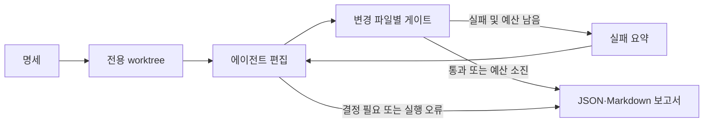

# MemeCatch AI 개발 하네스

작업 명세를 받아 로컬 `origin/main`의 전용 worktree에서 코드를 수정하고 검증한다. 검사가 실패하면 테스트 이름과 오류 위치를 다음 에이전트 호출에 전달한다.



- [AI 서비스 설계](ai-service.md) · 사용자 흐름, 수용 기준과 미구현 제안
- [에이전트 규칙](agent-rules.md) · 명세 범위, worktree, 권한과 완료 보고
- [실행 환경](environment.md) · Node·Rust·Docker 준비와 테스트 격리
- [검증 기준](verification.md) · 변경 경로별 게이트와 통과 조건

## 실행

저장소 루트에서 실행한다. `task.md`에 목표, 변경 가능 경로, 수용 기준을 적고 원하는 에이전트 하나를 선택한다.

```bash
node scripts/harness/run.mjs --task task.md --agent codex
node scripts/harness/run.mjs --task task.md --agent claude

# 오프라인 스텁 · 1회차 실패, 2회차 통과
stub_spec="$(mktemp)"
printf '# Implement the colour contract\n' > "$stub_spec"
node scripts/harness/run.mjs --task "$stub_spec" --agent node \
  --agent-arg="$PWD/scripts/harness/fixtures/stub-agent.mjs" --gates node --max-iterations 2
rm "$stub_spec"

# 하네스 자체 테스트
node --test scripts/harness/
```

종료 시 출력되는 경로 또는 `~/.cache/memecatch-harness/run-*/`에서 `report.md`를 먼저 연다. 최종 판정, 반복별 실패 요약, 검사 생략 범위, 변경 파일과 로그 링크가 있다. 자동 처리는 `report.json`을 읽는다. 스텁의 `green`은 Node 게이트에 한정된다.

사람은 worktree의 diff와 수용 기준을 검토하고, 필요한 검사를 확인한 뒤 커밋·push·PR을 진행한다. 하네스는 결과와 작업 브랜치를 보존한다.
