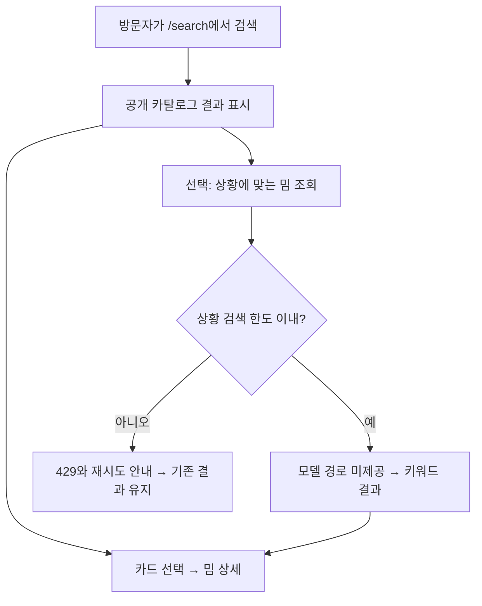
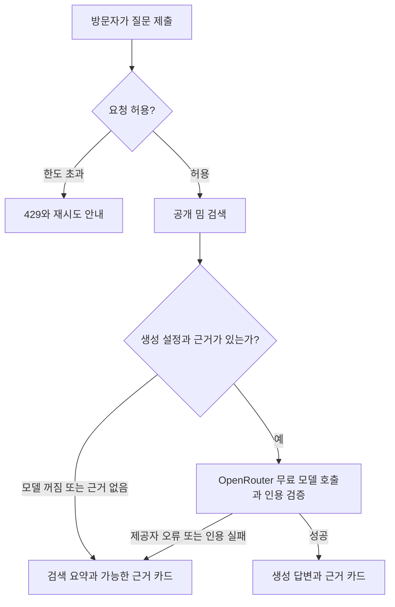
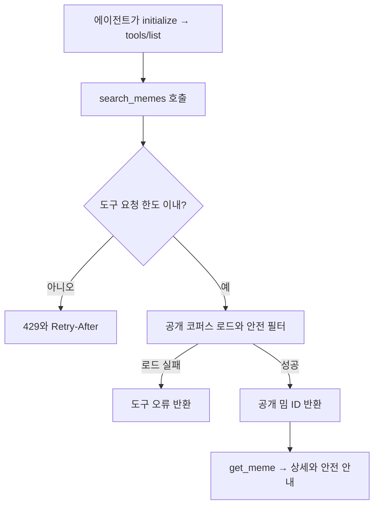
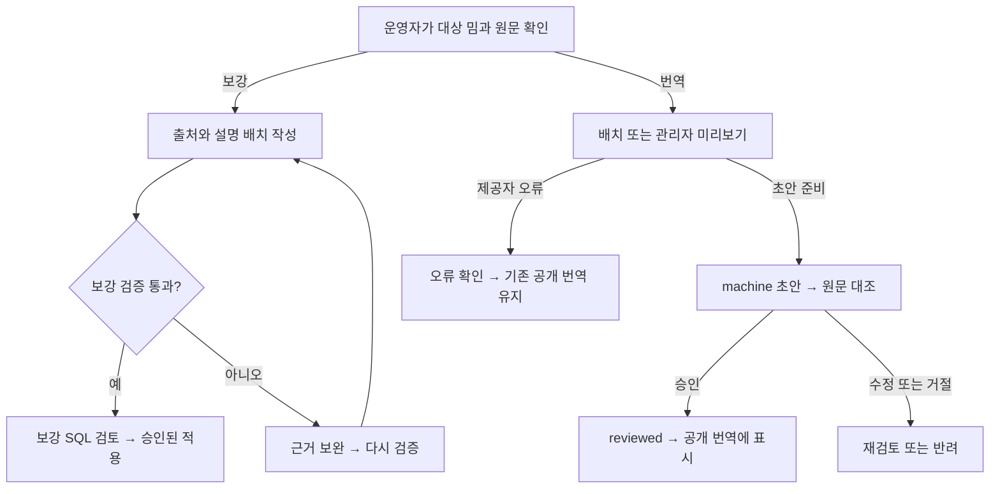

# MemeCatch AI 서비스 설계

## 현재 구현과 수용 기준

아래 기준은 Axum 코드와 Compose 기본값을 따르며 로컬 fixture와 제공자 스텁으로 확인할 수 있다. 운영 플래그와 실제 제공자 가용성은 별도 확인 대상이다.

### 밈 검색 · 방문자

- **AI-SEARCH-01 · 기능.** `/search?q=…`에서 이름·별칭을 조회하고 결과를 눌러 밈 상세를 연다. 공개·비공개 밈이 같은 별칭을 가진 fixture에서 노출 가능한 결과만 표시되고, 카드 링크의 상세 제목이 결과와 일치하면 통과한다. [검색 페이지](../../server/src/pages/search.rs)
- **AI-SEARCH-02 · 비기능.** 상황 검색 API는 키워드로 응답하며, 플래그가 꺼져 있으면 `disabled`, 켜져 있으면 `model_unavailable`을 반환한다. 요청 본문 2 KiB 초과는 400, 같은 인스턴스에서 같은 IP의 분당 21번째 요청은 429와 `Retry-After`를 반환해야 한다. [상황 검색 API](../../server/src/routes/search.rs)

### 임베딩 · 운영자와 인증된 클라이언트

- **AI-EMBED-01 · 기능.** 고정 리비전 E5 모델을 올린 Compose `embedder`가 유효하게 서명된 `POST /v1/embeddings`에 384차원 벡터를 반환한다. 재색인 플래그를 끈 상태에서 cron GET은 202 `disabled`를 반환해야 한다. [임베딩 API](../../server/src/routes/embeddings.rs), [모델 준비](../../scripts/prepare-meme-embedding-model.mjs)
- **AI-EMBED-02 · 비기능.** CPU에서 처리해 외부 모델 호출 비용이 없고 호출 제한은 120초다. 런타임을 설정한 fixture에서 잘못된 서명은 401, 모델 서비스가 없으면 503을 반환해야 한다. 같은 질의의 캐시 적중과 300초 이후 갱신을 확인한다. [인증](../../server/src/routes/embeddings/auth.rs), [런타임](../../server/src/routes/embeddings/runtime.rs)

### 캐릭터 챗 · 방문자

- **AI-CHAT-01 · 기능.** 질문을 제출하면 공개 밈을 검색해 답변과 근거 카드를 표시한다. 스텁이 조회된 근거 ID만 인용한 답변을 반환하면 `generated`와 해당 카드 링크가 표시되어야 한다. 키가 없거나 생성이 꺼져 있거나 제공자 응답이 실패하면 검색 근거를 유지한다. [챗 API](../../server/src/routes/chat.rs)
- **AI-CHAT-02 · 비기능.** 질문 최대 120자, 생성 12초, 요청 전체 25초를 적용한다. 같은 IP의 10분 내 6번째 요청은 429다. 스텁에서 제공자에 보낸 사용자 메시지가 현재 질문·언어·공개 근거로 제한되고, 모델의 요청·입력·출력 가격 상한이 모두 0인지 검사한다. 화면에는 제공자 전송 범위를 알리며 별도 대화 저장 테이블은 없다. [생성 경계](../../server/src/routes/chat/generate.rs), [챗 UI](../../server/ui/chat.js)

### 공개 MCP · 외부 AI 에이전트와 운영자

- **AI-MCP-01 · 기능.** JSON-RPC `initialize` → `tools/list` → `search_memes` → `get_meme`에서 같은 공개 밈 ID와 안전도·출처 정보를 확인한다. `/api/mcp-operator`는 OAuth 메타데이터와 인증 요청을 제공하고 운영 토큰·구독 발급은 비활성 상태다. [공개 도구](../../server/src/routes/mcp/protocol.rs), [운영 경로](../../server/src/routes/mcp.rs)
- **AI-MCP-02 · 비기능.** 공개 도구는 읽기 전용이다. 검색 기본값에서 위험·안전 미확인 fixture가 제외되고, 요청 본문 256 KiB와 분당 IP 120회·인스턴스 1,200회 한도가 적용되어야 한다. 코퍼스 스텁이 12초 제한을 넘기면 도구 결과는 `isError: true`다. [요청 경계](../../server/src/routes/mcp/public.rs), [코퍼스](../../server/src/routes/mcp/corpus.rs)

### 콘텐츠 보강과 번역 · 운영자와 방문자

- **AI-EDITORIAL-01 · 기능.** 번역 누락·구버전 항목은 Anthropic 배치, 로컬 MLX 또는 관리자 GPT 경로에서 검수 대상으로 만든다. 관리자 미리보기 저장 직후에는 `machine` 상태로 공개 상세의 번역 목록에 없고, 승인 후 `reviewed`가 되면 목록에 표시되어야 한다. 보강 배치는 공개 밈의 출처·기원·주의 문구를 확인하고 승인 검토용 SQL을 출력한다. [번역 배치](../../scripts/translate-memes.mjs), [검수](../../server/src/routes/admin/translation_drafts.rs), [보강](../../scripts/enrich-public-memes.mjs)
- **AI-EDITORIAL-02 · 비기능.** 공개 페이지 조회와 MLX 기본 dry-run에서 제공자 호출은 0회다. Anthropic·GPT 호출은 별도 배치 또는 운영 요청으로 제한하며 비용이 들 수 있다. 제공자 오류 또는 원문 변경 시 승인 상태가 바뀌지 않아야 한다. 근거가 없거나 ID가 중복된 보강 fixture는 거절되고, 유효한 SQL은 공개 상태와 기존 안전 검수 일시를 보존해야 한다. [로컬 MLX](../../scripts/translate-memes-mlx-linked.mjs), [공개 번역 조건](../../server/src/pages/meme_detail/translations.rs)

### MPE 미디어 · 업로더와 운영자

- **AI-MPE-01 · 기능.** 스토리지 설정과 권리 확인이 있는 세션에서 업로드하면 처리 작업이 생성된다. 스텁 워커로 프레임·OCR·지문 처리 후 작업 조회에서 결과를 확인하고, 운영자가 후보·렌더를 검토한다. 후보 매칭·근거 저장 RPC의 배열 타입 불일치가 현재 알려진 실패다. [MPE API](../../server/src/routes/mpe.rs), [후보 저장](../../server/src/routes/mpe/candidate_post.rs)
- **AI-MPE-02 · 비기능.** 권리 확인이 빠진 업로드는 400 `rights_required`다. FFmpeg 기본 제한 20분, ffprobe 30초를 적용한다. 예산 예약이 거절되면 모델 호출이 0회이고, 처리·저장소 실패는 작업 오류로 남으며 공개 상태를 바꾸지 않아야 한다. [업로드](../../server/src/routes/mpe/uploads.rs), [워커](../../scripts/mpe-media-worker.mjs), [모델 예산](../../lib/mpe/openrouter.server.ts)

### 트렌드 레이더 · 운영자와 방문자

- **AI-RADAR-01 · 기능.** 인증된 trend-pulse가 점수를 계산하고 설정된 Instagram·Threads·X의 공개 신호를 매칭한다. 운영자가 승인한 신호만 후속 집계의 `reviewed_signals`에 한 번 반영되고, 이후 알림과 공개 페이지가 갱신되어야 한다. [트렌드 펄스](../../server/src/routes/ops/trend_pulse.rs), [승인 신호](../../server/src/routes/ops/radar_approved.rs)
- **AI-RADAR-02 · 비기능.** 생성 모델 호출 없이 집계한다. 커넥터가 없으면 외부 수집을 건너뛰고 점수·알림을 처리한다. 커넥터 스텁이 30초 제한을 넘기면 `partial`을 기록하고 점수·알림 경로를 유지해야 한다. [레이더](../../server/src/routes/ops/radar.rs)

### Meme Studio · 방문자와 운영자

- **AI-STUDIO-01 · 기능.** 방문자의 주제·톤·형식이 유효하면 공개 API가 `template` 모드로 초안 3개를 반환한다. 운영자 요청은 Bedrock 플래그와 예산이 허용될 때 승인된 모델에서 초안 3개를 가져온다. [Studio API](../../server/src/routes/studio.rs)
- **AI-STUDIO-02 · 비기능.** 공개 경로는 모델 호출 0회이며 같은 IP의 시간당 11번째 요청을 429로 거절한다. 관리자 플래그가 꺼져 있으면 `bedrock_unavailable`을 반환하고, 예산 예약을 거절한 fixture에서도 Bedrock 호출은 0회여야 한다. [공개 템플릿](../../server/src/routes/studio/public.rs), [Bedrock 운영 기준](../operations/bedrock-meme-studio.md)

## 현재 사용자 흐름

### 방문자 검색 → 밈 상세 · AI-SEARCH-01~02

### 캐릭터 챗 · AI-CHAT-01~02

### 외부 AI 에이전트 MCP 조회 · AI-MCP-01~02

### 운영자 번역·보강 검토 · AI-EDITORIAL-01~02

## 제안 · 미구현

- **AI-SEARCH-03.** Axum에 벡터 검색을 연결한다. 고정 질의 세트에서 키워드와 벡터 검색의 상위 결과 적합도와 p95를 비교한다. 모델 미기동·시간 초과 fixture에서도 키워드 결과와 상세 링크가 반환되어야 한다.
- **AI-MCP-03.** 별도 승인 후 OAuth와 이벤트 수명주기를 구현한다. 만료·취소된 자격증명이 거절되고, 전달 실패를 재시도해도 이벤트가 중복 처리되지 않는지 스텁으로 확인한다.
